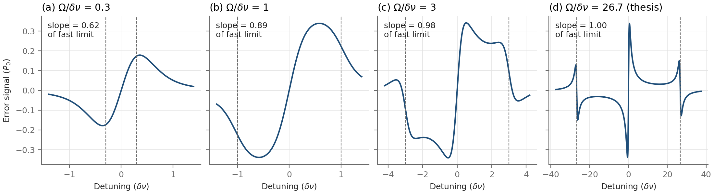
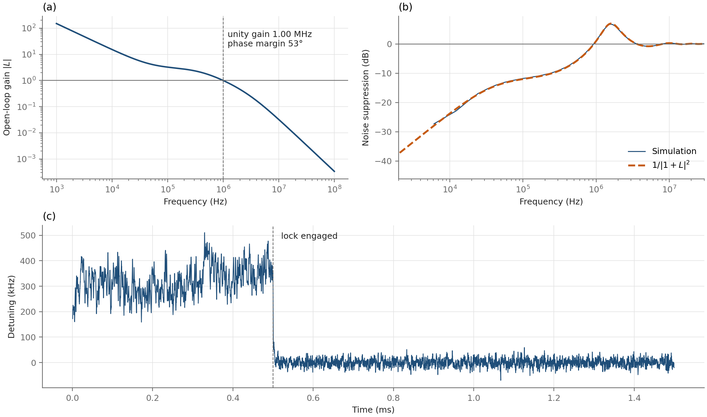

This side project is a Python simulation of a Pound–Drever–Hall (PDH) lock of an external-cavity diode laser to a Fabry–Pérot reference cavity. The simulation follows a laser-frequency fluctuation from the laser, through the cavity and the servo electronics, and back to the laser. It is built in four steps, and each step is checked against an independent calculation before the next step uses it. The code, the figures, and a full derivation are available in the [GitHub repository](https://github.com/brianyang565/pdh-lock-sim).

The shape of the error signal depends on the ratio of the modulation frequency Ω to the cavity linewidth δν. In our experiment, this ratio is 27, so the central slope and the two sideband features at ±20 MHz are well separated, and the slope lies within 0.1% of its largest possible value. As the ratio decreases, the three features merge into a single broad feature and the central slope becomes shallower, because the sidebands are then partly transmitted through the cavity instead of being reflected as a clean reference.

A round-trip simulation of the cavity field reproduces the analytic PDH error signal, and it shows that the cavity responds to laser frequency noise as a single low-pass filter at its half-width of 375 kHz, to within 0.1% up to 1 MHz. A closed-loop model built on this result reproduces the analytic noise suppression and the servo bump. The model acquires lock from any detuning within the 20 MHz modulation frequency, and it locks falsely at 32.3 MHz when started beyond that range. The residual noise is lowest at a proportional gain of 2.5, well below the instability at 6.0, because additional gain enlarges the servo bump faster than it reduces the low-frequency noise.

I then compared the model with the measured frequency noise of the cavity-transmitted light in our experiment, which implies a residual detuning of about 160 kHz rms, or 45% of the cavity half-width. Fits of the full nonlinear simulation to this spectrum place the unity-gain frequency at 560–620 kHz. The measured level is consistent either with a laser 17 times noisier than assumed or with technical noise at the error-signal point. These two explanations predict spectra that differ by a factor of 18 at 1 kHz, which identifies the measurement that would distinguish them. The free-running noise of the laser has not been measured in our experiment, so the noise model is an assumption, and the repository states this and the other limitations of the comparison.
